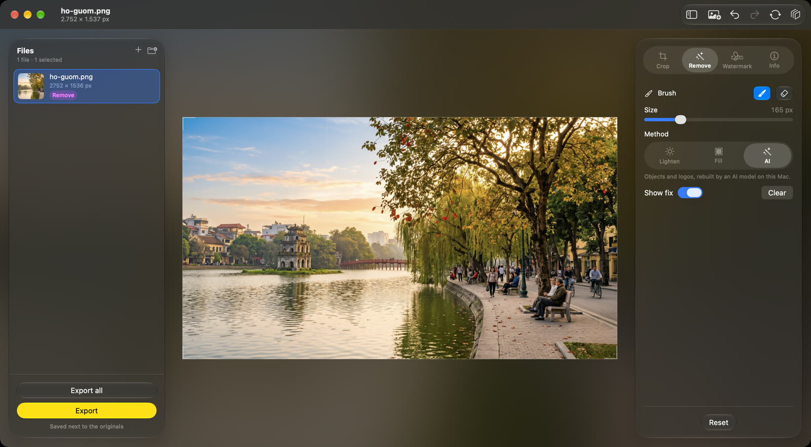
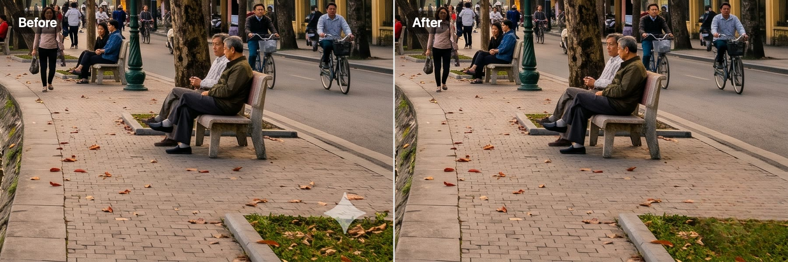
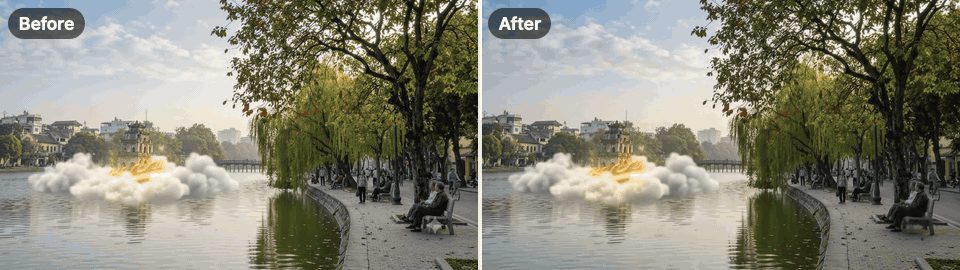
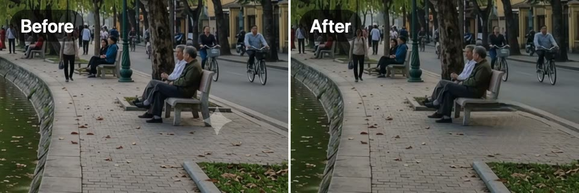
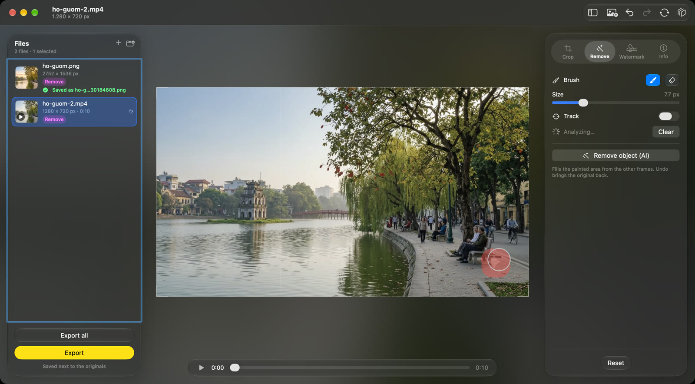
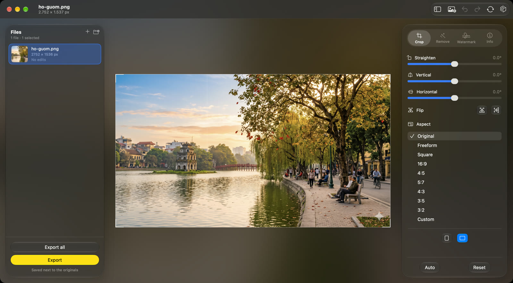

  

<h1 align="center">Framelume</h1>

  Crop, clean up and watermark your photos and videos, right on your Mac.

  <a href="https://github.com/hoangvunam/Framelume/releases/download/v1.0/Framelume-1.0.zip"><b>⬇ Download Framelume 1.0</b></a> (4 MB) ·
  macOS 13 or later · free ·
  <a href="https://github.com/hoangvunam/Framelume/releases">all releases</a>

## Remove logos and objects with AI

Paint over a logo, a sticker or anything that should not be there, and Framelume rebuilds what was behind it. Here it removes the Gemini sparkle from the corner of an AI-generated picture of Hoan Kiem Lake.

**Photo**: the LaMa model fills the painted area, running on your Mac with Core ML.

**Video**: paint the mask once and ProPainter rebuilds the area from the other frames, so the fix holds through the whole clip, even while the camera moves. Turn on Track and the mask follows a moving object.

## Everything else it does

- **Crop and straighten.** Drag the crop frame on the picture, pick a ratio (square, 16:9, 4:5, 3:2 and more) or type your own. Straighten, fix perspective, flip. Auto finds the horizon for you.
- **Dust spots.** Lighten brings back a soft sensor-dust shadow and keeps the detail under it; Fill rebuilds small dark specks from the texture around them.
- **Watermark.** Text or a logo, placed and sized on the preview, with font, colour, background, corner radius and opacity.
- **Metadata.** View and edit Exif, IPTC, TIFF and GPS for images or the tags of a video, or strip everything before sharing.
- **Many files at once.** Drop in a folder, edit one file, save the steps as a preset and apply them to the whole batch, then export everything in one go.

Everything runs on your Mac with Core Image, AVFoundation, Vision and Core ML. No account, no uploads. Exports are saved next to the original under a new name, so the original is never overwritten.

## Install

1. Download [Framelume-1.0.zip](https://github.com/hoangvunam/Framelume/releases/download/v1.0/Framelume-1.0.zip) and unzip it.
2. Drag **Framelume.app** to Applications and open it.

The app is signed with Developer ID and notarized by Apple, so it opens without a Gatekeeper warning.

**AI models (optional, installed once from Settings › Object Removal):**

- Photos: LaMa, about 190 MB.
- Video: ProPainter with PyTorch, about 1.5 GB. Needs Python 3.10 or later on the Mac; 16 GB of RAM is recommended. ProPainter is licensed under NTU S-Lab 1.0, for non-commercial use only.

---

This repository hosts the app downloads. SHA-256 of Framelume-1.0.zip: `09a8994cf07d0d2bbb25591e1d371d0f37e62e6ad1542bc74dfdc2acf1d68165`
